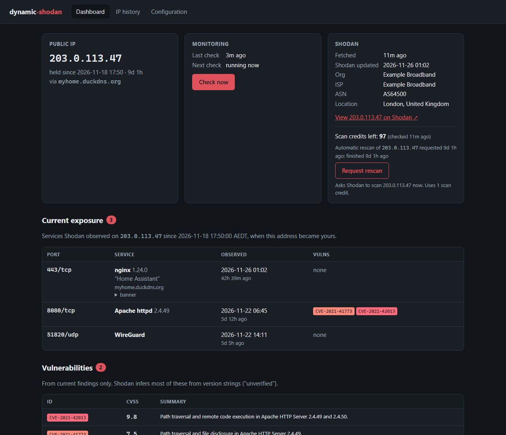

# dynamic-shodan

A small self-hosted web app that shows what [Shodan](https://www.shodan.io/) can see on your home or office connection, even when that connection has a **dynamic public IP**.



<sub>Dashboard with demo data (documentation IP ranges, example vulnerabilities).</sub>

## Summary

Shodan indexes services by IP address. On a dynamic connection your address changes every so often, and whatever Shodan has on file for your new IP was usually recorded while it belonged to **someone else**. Looking it up by hand gives you a mix of your exposure and a stranger's.

dynamic-shodan fixes that:

1. It resolves your **dynamic DNS hostname** on a schedule to find your current public IP.
2. It keeps an **IP history**: one entry for each continuous stretch you held an address, with first-seen and last-seen timestamps.
3. It pulls **Shodan host intel** for the current IP and **disregards stale findings**. Any service Shodan recorded *before* the address became yours is shown separately and not counted.
4. Optionally, it asks Shodan for an **on-demand rescan** when your IP changes, so you get fresh data about *your* services instead of waiting days for Shodan's next crawl.

It's a single self-contained binary: Go standard library only, no cgo, templates and CSS embedded. It runs on Windows, macOS, Linux and FreeBSD, and as a multi-arch Docker image.

## Quick start

You need a [Shodan API key](https://account.shodan.io/) and a dynamic DNS hostname that points at your connection (for example `myhome.duckdns.org`).

**With Docker:**

```sh
docker run -d --name dynamic-shodan \
  -p 8080:8080 \
  -e DYNAMIC_SHODAN_AUTH=admin:change-me \
  -v ./config:/config \
  ghcr.io/<owner>/dynamic-shodan:latest
```

**Or from source** (Go 1.25+):

```sh
git clone https://github.com/<owner>/dynamic-shodan.git
cd dynamic-shodan
go run .
```

Then:

1. Open <http://localhost:8080/> (log in with the `DYNAMIC_SHODAN_AUTH` credentials if you set them).
2. Go to **Configuration**, paste your Shodan API key and click **Test API key**.
3. Enter your DDNS hostname and **Save**.
4. Back on the **Dashboard**, click **Check now**. Your IP, Shodan intel and any current exposure appear within a few seconds.
5. If you've had the same IP for a while, open **IP history** and set the real start date (see [First run](#first-run-set-your-real-start-date)).

---

## Running it

### Command-line flags

| Flag | Default | Description |
|---|---|---|
| `-listen` | `127.0.0.1:8080` | Address and port for the web UI |
| `-data` | *OS config dir* `/dynamic-shodan` | Where `config.json` and `state.json` live |
| `-auth` | env `DYNAMIC_SHODAN_AUTH` | Optional HTTP basic auth, `user:password` |
| `-version` | | Print the version and exit |

By default the UI listens on **loopback only**. If you bind to anything else (`-listen 0.0.0.0:8080`), set `-auth`: without it, anyone who can reach the port can view your intel and change settings, and the app logs a warning at startup.

### Data directory

| OS | Default `-data` location |
|---|---|
| Windows | `%AppData%\dynamic-shodan` |
| macOS | `~/Library/Application Support/dynamic-shodan` |
| Linux / BSD | `$XDG_CONFIG_HOME/dynamic-shodan` (usually `~/.config/dynamic-shodan`) |
| Docker | `/config` |

It holds two files:

- `config.json`: settings and the Shodan API key. The key is stored in plain text (mode `0600` on Unix) and is never sent back to the browser; the UI only shows a short hint of it.
- `state.json`: IP history, the latest cached Shodan scan per IP, rescan status and the last known credit balance.

Back up the directory to keep your history. Delete `state.json` to start over without losing settings.

### Windows

Download `dynamic-shodan-<version>-windows-amd64.exe` (or `arm64`) from the releases page, or build it yourself:

```powershell
go build -o dynamic-shodan.exe .
.\dynamic-shodan.exe
```

To keep it running in the background, create a Task Scheduler task that runs at log on (or at startup, under your account so `%AppData%` resolves):

```powershell
$action  = New-ScheduledTaskAction -Execute "C:\Tools\dynamic-shodan.exe"
$trigger = New-ScheduledTaskTrigger -AtLogOn
Register-ScheduledTask -TaskName "dynamic-shodan" -Action $action -Trigger $trigger
```

### macOS

```sh
go build -o dynamic-shodan .
./dynamic-shodan
```

Prebuilt binaries are available for `darwin-arm64` (Apple silicon) and `darwin-amd64` (Intel). Downloaded binaries aren't notarized, so clear the quarantine flag first: `xattr -d com.apple.quarantine ./dynamic-shodan`. To run it at login, use a `launchd` agent in `~/Library/LaunchAgents/` with `RunAtLoad` and `KeepAlive` set to `true`.

### Linux

```sh
go build -o dynamic-shodan .
./dynamic-shodan
```

Prebuilt binaries exist for `linux-amd64`, `linux-arm64` (Raspberry Pi 4/5) and `linux-armv7` (older Pis). A minimal systemd unit:

```ini
# /etc/systemd/system/dynamic-shodan.service
[Unit]
Description=dynamic-shodan
After=network-online.target
Wants=network-online.target

[Service]
User=dynamic-shodan
ExecStart=/usr/local/bin/dynamic-shodan -listen 0.0.0.0:8080 -data /var/lib/dynamic-shodan
Environment=DYNAMIC_SHODAN_AUTH=admin:change-me
StateDirectory=dynamic-shodan
Restart=on-failure

[Install]
WantedBy=multi-user.target
```

```sh
sudo useradd --system --no-create-home dynamic-shodan
sudo systemctl enable --now dynamic-shodan
```

The app shuts down cleanly on `SIGINT` / `SIGTERM`.

### FreeBSD

A `freebsd-amd64` binary is built by CI. Run it directly, or wrap it in an `rc.d` script with `daemon(8)`.

### Docker

The image follows [LinuxServer.io](https://www.linuxserver.io/) conventions: it's built on `ghcr.io/linuxserver/baseimage-alpine` with s6-overlay, the app runs as user `abc` mapped to `PUID`/`PGID`, and all state lives in `/config`. Images are multi-arch (`linux/amd64`, `linux/arm64`) and published to GHCR by CI.

#### docker compose

```yaml
services:
  dynamic-shodan:
    image: ghcr.io/<owner>/dynamic-shodan:latest
    container_name: dynamic-shodan
    environment:
      - PUID=1000
      - PGID=1000
      - TZ=Etc/UTC
      - DYNAMIC_SHODAN_AUTH=admin:change-me   # optional, recommended
    volumes:
      - /path/to/dynamic-shodan/config:/config
    ports:
      - 8080:8080
    restart: unless-stopped
```

#### docker cli

```sh
docker run -d \
  --name=dynamic-shodan \
  -e PUID=1000 -e PGID=1000 -e TZ=Etc/UTC \
  -e DYNAMIC_SHODAN_AUTH=admin:change-me \
  -p 8080:8080 \
  -v /path/to/dynamic-shodan/config:/config \
  --restart unless-stopped \
  ghcr.io/<owner>/dynamic-shodan:latest
```

#### Parameters

| Parameter | Function |
|---|---|
| `-p 8080:8080` | Web UI |
| `-e PUID=1000` | User ID that owns `/config` |
| `-e PGID=1000` | Group ID that owns `/config` |
| `-e TZ=Etc/UTC` | Timezone used for displayed timestamps |
| `-e UMASK=022` | Optional umask for created files |
| `-e DYNAMIC_SHODAN_AUTH=user:pass` | Optional HTTP basic auth for the UI |
| `-v /config` | `config.json` and `state.json` |

#### Image tags

| Tag | Built from |
|---|---|
| `latest` | The `main` branch |
| `1.2.3`, `1.2` | Release tags `v1.2.3` |
| `sha-abc1234` | Any pushed commit |

#### Building the image yourself

```sh
docker build -t dynamic-shodan --build-arg VERSION=local .
# multi-arch:
docker buildx build --platform linux/amd64,linux/arm64 -t dynamic-shodan .
```

The Dockerfile cross-compiles on the build host's native platform, so multi-arch builds don't need QEMU for the Go step.

#### DNS inside the container

The container resolves your hostname with Docker's DNS. If your network uses split-horizon DNS (your DDNS name resolves to a LAN address internally), set a public **DNS server** on the Configuration page so the app sees your real public IP.

### Cross-compiling

Every target builds from any host with `CGO_ENABLED=0`:

```sh
CGO_ENABLED=0 GOOS=linux   GOARCH=amd64 go build -o dist/dynamic-shodan-linux-amd64 .
CGO_ENABLED=0 GOOS=linux   GOARCH=arm64 go build -o dist/dynamic-shodan-linux-arm64 .
CGO_ENABLED=0 GOOS=linux   GOARCH=arm GOARM=7 go build -o dist/dynamic-shodan-linux-armv7 .
CGO_ENABLED=0 GOOS=darwin  GOARCH=arm64 go build -o dist/dynamic-shodan-darwin-arm64 .
CGO_ENABLED=0 GOOS=windows GOARCH=amd64 go build -o dist/dynamic-shodan-windows-amd64.exe .
CGO_ENABLED=0 GOOS=freebsd GOARCH=amd64 go build -o dist/dynamic-shodan-freebsd-amd64 .
```

PowerShell:

```powershell
$env:CGO_ENABLED='0'; $env:GOOS='linux'; $env:GOARCH='arm64'; go build -o dist/dynamic-shodan-linux-arm64 .
```

Add `-trimpath -ldflags "-s -w -X main.version=1.2.3"` for smaller release builds with a version string.

### Releases and CI

The GitHub Actions workflow ([`.github/workflows/build.yml`](.github/workflows/build.yml)):

- runs `go vet` and `go test` on Linux (with `-race`), Windows and macOS;
- builds binaries for linux amd64/arm64/armv7, darwin amd64/arm64, windows amd64/arm64 and freebsd amd64;
- builds the multi-arch image and pushes it to GHCR (not for pull requests);
- on a `v*` tag, creates a GitHub release with every binary and a `SHA256SUMS` file.

---

## Functionality

### Dashboard (`/`)

The main page, shown in the screenshot above.

- **Public IP card**: the current address, when you started holding it and for how long, and the hostname it was resolved from. Shows "start set manually" if you adjusted it in IP history.
- **Monitoring card**: time of the last and next check, the last error (DNS failure, Shodan error, and so on), and a **Check now** button that resolves the hostname and re-queries Shodan immediately.
- **Shodan card**: when the intel was fetched and when Shodan last updated the host, plus org, ISP, ASN, location and OS, and a link to the host's page on shodan.io. It also shows your remaining **scan credits**, the status of the latest rescan, and a **Request rescan** button.
- **Current exposure**: services Shodan observed *after* the address became yours: port and transport, product and version, page title, hostnames, an expandable raw banner, when it was observed, and any CVEs, colored by CVSS severity.
- **Vulnerabilities**: CVEs from current services only, sorted by CVSS, with summaries and a *verified* tag where Shodan confirmed the issue. (Most Shodan CVEs are inferred from version strings.)
- **Stale, disregarded**: a collapsed section with services recorded before you held the IP, each with the reason it was ignored, for example *"observed 2026-10-23, before this IP was yours (since 2026-11-18)"*.

If Shodan has nothing indexed for your IP, the dashboard says so. `/?ip=X` shows the cached intel for a previous IP from your history.

### IP history (`/history`)

One row per continuous stretch you held an address, newest first, with first-seen, last-seen and duration. Each row links to the cached intel for that IP.

You can edit the **start date** of any period. Use this after first install: the app can only know you've had an address since it first saw it, so if you've had it for months, set the real date and older findings will count as current.

### Configuration (`/config`)

| Setting | Description |
|---|---|
| **Shodan API key** | From [account.shodan.io](https://account.shodan.io/). Host lookups don't use query credits. **Test API key** checks it in place and shows your plan and credits. |
| **Hostname** | Your DDNS name, for example `myhome.duckdns.org`. |
| **DNS server** | Optional. Query a specific server directly (your DDNS provider's authoritative nameserver, or `1.1.1.1`) to avoid stale caches and split-horizon answers. |
| **Check interval** | How often to re-resolve the hostname. Default 10 minutes. |
| **Shodan refresh** | How often to re-query Shodan when the IP hasn't changed. Default 12 hours. Shodan is always re-queried immediately when the IP changes. |
| **Request a Shodan rescan when my IP changes** | Optional. See below. |

### On-demand rescans

Shodan crawls each address only every few days, so right after an IP change its data mostly describes the previous holder. A rescan asks Shodan to scan your IP now.

- **Automatic**: with the setting on, the app requests a rescan whenever your IP changes.
- **Manual**: the dashboard's **Request rescan** button scans the current IP at any time. It's disabled while a rescan of that IP is still running or when you have no credits left.

While a rescan is running, the app checks its progress every 2 minutes and re-fetches the host data when Shodan finishes. It stops following a scan after 24 hours. Each rescan uses **1 scan credit**, which requires a paid Shodan plan.

### How staleness is decided

- Each Shodan service banner has a `timestamp`: when Shodan's crawler observed it.
- Each scan is matched to the ownership period it was fetched in. A service is **current** if its timestamp is on or after that period's *first seen*. Otherwise it's **stale**.
- Vulnerabilities are aggregated **from current services only**.
- If you get an old address back (A → B → A), only findings from the latest stretch of A count.
- IP changes are detected at the check interval, so the real switch happened somewhere between the old IP's *last seen* and the new IP's *first seen*. The app uses *first seen* as the boundary, which errs on the side of discarding. A shorter check interval narrows the gap.

#### First run: set your real start date

On first launch the app records your current IP as held "since now", so everything Shodan already has on file looks stale. If you've actually had that IP for a while, open **IP history** and set the real start date.

### JSON API

`GET /api/status` returns a JSON summary for scripts and monitoring: current IP and ownership period, current services and vulnerabilities, stale-finding count and the last error. It uses the same basic auth as the UI.

```sh
curl -u admin:change-me http://localhost:8080/api/status
```

### Endpoints

| Method | Path | Purpose |
|---|---|---|
| `GET` | `/` | Dashboard (`?ip=X` for a previous IP) |
| `GET` | `/history` | IP ownership history |
| `POST` | `/history/{idx}/start` | Set a period's start date |
| `GET` / `POST` | `/config` | View / save settings |
| `POST` | `/config/test` | Test the API key |
| `POST` | `/check` | Check now |
| `POST` | `/rescan` | Request a Shodan rescan |
| `GET` | `/api/status` | JSON status |

### Security

- Loopback-only by default; optional HTTP basic auth for everything else.
- Form posts are protected against cross-site requests (`http.CrossOriginProtection`).
- Pages send a strict Content-Security-Policy.
- The API key never leaves the server after you save it.

## Development

```sh
go test ./...
go vet ./...
```

| Package | Responsibility |
|---|---|
| `internal/model` | Types and staleness rules |
| `internal/store` | JSON persistence and IP history |
| `internal/shodan` | Shodan API client |
| `internal/monitor` | Scheduler: DNS checks, Shodan refreshes, rescans |
| `internal/web` | HTTP handlers, embedded templates and CSS |
| `root/` | s6-overlay service definitions for the container |
